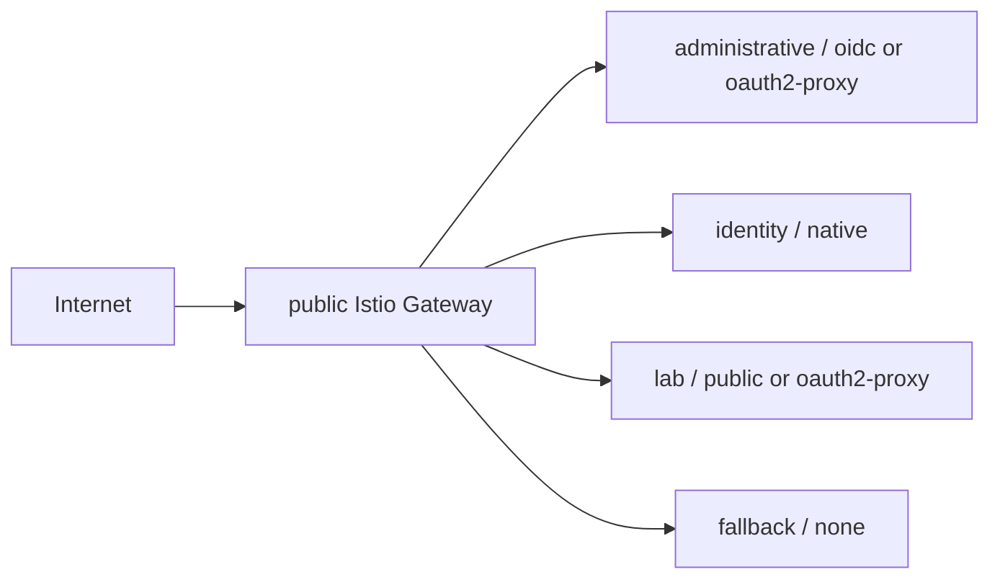

# terraform-kubernetes-platform-tools

Terraform modules for Kubernetes platform tools that run on an existing cluster.

This repository is intentionally separate from OCI infrastructure modules. The
OCI repository should create cloud resources such as VCNs, OKE, DNS, Object
Storage, Registry, and MySQL. This repository installs and configures tools
inside Kubernetes using Helm, Kubernetes manifests, and application providers.

## Modules

- [`platform`](modules/platform/): Gateway API, cert-manager, ExternalDNS, Istio ambient, public Gateway, waypoint, and Bookinfo lab.
- [`observability`](modules/observability/): Kiali, kube-prometheus-stack, Grafana, Loki, Tempo, routes, and optional OIDC.
- [`lab-apps`](modules/lab-apps/): Optional Bookinfo auto-instrumentation, OpenTelemetry Demo, and lab routes.
- [`argocd`](modules/argocd/): Argo CD GitOps delivery through the shared Gateway.
- [`keycloak`](modules/keycloak/): Keycloak runtime on Kubernetes with MySQL-backed persistence.
- [`keycloak-config`](modules/keycloak-config/): Keycloak realm, groups, OIDC clients, and protocol mappers using `keycloak/keycloak`.

## Expected Inputs

Root stacks using these modules should provide:

- kubeconfig path and `kubectl` path
- base domain and app hostnames
- public Gateway/NLB target IP when DNS is managed by ExternalDNS
- OCI compartment/region only when using OCI-specific integrations such as DNS01 or ExternalDNS OCI provider
- Object Storage S3-compatible credentials for Loki and Tempo
- MySQL endpoint and admin credentials for tools that need relational persistence

## Recommended Phases

1. Install platform: Gateway API, Istio, cert-manager, ExternalDNS, wildcard TLS.
2. Install observability and GitOps tools.
3. Install Keycloak runtime using MySQL.
4. Run `keycloak-config` after Keycloak is reachable.
5. Reconfigure Argo CD, Grafana, and Kiali to use Keycloak OIDC clients.

## Public Route Classification

HTTPRoutes created by these modules include labels that describe exposure and
authentication. This keeps public routes auditable without depending on host
name conventions alone.

Use these labels when reviewing public surfaces:

- `platform.wesleydutra.online/exposure-class`: `administrative`, `identity`,
  `lab`, or `fallback`.
- `platform.wesleydutra.online/auth`: `oidc`, `oauth2-proxy`, `native`,
  `public`, or `none`.

## Persistence Guidance

- Argo CD does not use MySQL by default; Kubernetes stores Applications, Secrets, and ConfigMaps, while Redis is cache.
- Keycloak should use MySQL for realm and user persistence.
- Grafana can use either a PVC or an external database for dashboards created through the UI.
- Loki and Tempo should use object storage for logs and traces.
- Prometheus should use a short-retention PVC for local metrics.

## References

- [ExternalDNS Gateway API source](https://kubernetes-sigs.github.io/external-dns/v0.21.0/docs/sources/gateway-api/)
- [Istio ambient mode](https://istio.io/latest/docs/ambient/)
- [Kiali OpenID Connect authentication](https://kiali.io/docs/configuration/authentication/openid/)
- [Keycloak Terraform provider](https://github.com/keycloak/terraform-provider-keycloak/tree/v5.7.0)
- [Argo CD SSO](https://argo-cd.readthedocs.io/en/stable/operator-manual/user-management/)

## License

MIT. See [LICENSE](LICENSE).
