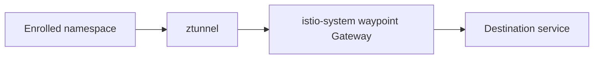
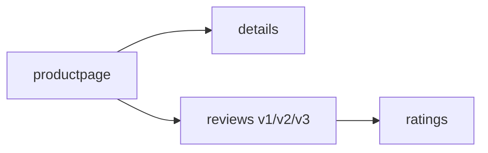

# platform

Installs the shared Kubernetes platform layer for an OCI OKE cluster.

## Components

- Gateway API CRDs
- cert-manager
- optional OCI DNS01 cert-manager webhook
- external-dns
- Metrics Server
- Istio ambient mode
- public Istio ingress gateway backed by an OCI Network Load Balancer
- optional no-cost public gateway hardening with security headers, denied scanner paths, and local rate limiting
- optional wildcard TLS certificate and HTTPS Gateway listener
- optional shared ambient waypoint in the Istio root namespace
- optional Istio Bookinfo sample in the `default` namespace

## Inputs

The caller must provide the base domain, ACME email, OCI region, compartment
OCID, kubeconfig path, and public ingress allowlist. Keep environment-specific
values in the root module, not in this module.

Example:

```hcl
module "platform" {
  source = "../modules/platform"

  domain_name                  = "example.com"
  acme_email                   = "admin@example.com"
  compartment_ocid             = module.foundation.compartment_ocid
  region                       = "us-phoenix-1"
  kubeconfig_path              = "~/.kube/config"
  public_gateway_allowed_cidrs = ["203.0.113.10/32"]
  enable_wildcard_certificate  = true
}
```

## DNS and TLS

When `enable_wildcard_certificate=true`, the module creates a ClusterIssuer and
a wildcard Certificate for `*.domain_name`. The HTTPS Gateway listener is applied
only after the certificate is ready.

The OCI DNS01 webhook expects the OKE nodes to have permission to manage TXT
records in the target zone, typically through instance principal policies.

## Cloudflare DNS (opt-in)

OCI continua sendo o padrão (`dns_provider = "oci"`). Cloudflare reutiliza o
solver DNS01 nativo do cert-manager e o provider mantido do ExternalDNS; não
instala o webhook OCI por padrão. Durante uma migração, habilite
`preserve_legacy_oci_webhook = true` para reter o release legado. Esta opção muda somente DNS: o gateway e o balanceador
continuam sendo OCI. Os inputs OCI existentes continuam obrigatórios por
compatibilidade com a interface do módulo.

Exemplo de configuração adicional no módulo consumidor (nomes e IDs são
ilustrativos e devem ser substituídos pelos recursos existentes):

```hcl
dns_provider                                      = "cloudflare"
preserve_legacy_oci_webhook                        = true
cluster_issuer_name                               = "letsencrypt-cloudflare"
enable_wildcard_certificate                       = true
cloudflare_api_token_secret_name                  = "cloudflare-dns01"
cloudflare_api_token_secret_key                   = "api-token"
external_dns_namespace                            = "kube-system"
external_dns_cloudflare_api_token_secret_name     = "cloudflare-external-dns"
external_dns_cloudflare_api_token_secret_key      = "api-token"
external_dns_zone_id_filters                      = ["<zone-id>"]
external_dns_txt_owner_id                         = "<unique-owner-id>"
external_dns_policy                               = "upsert-only"
```

Crie os Secrets por um fluxo seguro externo a este módulo antes da emissão ou
da atualização do ExternalDNS. O Secret do ClusterIssuer deve existir no
cluster resource namespace do cert-manager (normalmente `cert-manager`); o do
ExternalDNS deve existir em `external_dns_namespace`, que já deve existir.
Podem ser referências ao mesmo nome, mas Secrets são isolados por namespace.
O módulo não recebe, lê nem grava o valor do token no estado; Helm recebe
somente `valueFrom.secretKeyRef` para `CF_API_TOKEN`. Não passe tokens em
variáveis Terraform, argumentos CLI, arquivos versionados ou outputs.

Restrinja os tokens às zonas necessárias, com permissões Zone DNS Edit e Zone
Read. O ExternalDNS mantém `domainFilters = [domain_name]`, exige IDs de zona
explícitos e owner ID no modo Cloudflare, e não recebe argumentos OCI. O solver
DNS01 também seleciona somente `domain_name`. Os filtros não substituem a
restrição do token.

Para restringir registros a um conjunto explícito de hosts, configure
`external_dns_regex_domain_filter` com uma expressão regular ancorada (`^` e
`$`). Valores `null` ou vazios não adicionam o argumento. O
`--regex-domain-filter` do ExternalDNS sobrescreve `domainFilters`, não faz
interseção com ele: a expressão deve incluir explicitamente o domínio exato
autorizado e apenas os hosts desejados. Os filtros de IDs de zona continuam
aplicáveis. Por exemplo, `^((app|api)\.example\.com)$` restringe aos dois hosts
ilustrativos; adapte e escape as barras conforme HCL ou JSON. Não inclua
wildcard DNS se ele não fizer parte do escopo: uma HTTPRoute de fallback com
`*.domain_name` também é uma fonte potencial de registros. A regex não remove
registros preexistentes por si só nem autoriza alterar outros hosts.

`external_dns_policy` aceita `sync`, `upsert-only` e
`create-only`; `sync` permanece o default legado e pode remover registros sob
sua propriedade. Preserve o owner ID dos registros já gerenciados; não troque
o owner ID sem um plano explícito de adoção dos TXT de registro.

Sequência de migração e validação:

1. Inspecione estado, configuração completa do consumidor e plano; mantenha
   cópias protegidas da configuração e do estado. Confirme contexto do cluster,
   namespaces, zonas e Secrets sem imprimir credenciais.
2. Selecione um novo `cluster_issuer_name`, sem sobrescrever o issuer legado.
   O Secret da conta ACME recebe o sufixo `-account-key` nesse novo nome. Criar
   uma nova conta pode consumir limites ACME. O issuer legado não é apagado
   pelos provisioners deste módulo; preserve também as dependências antigas
   até concluir o rollback window.
3. Prepare o novo issuer e atualize o Certificate; aguarde `Ready=True` e
   confira os nomes DNS, validade e Secret TLS antes de alterar o gateway ou
   publicar registros. A dependência existente garante Certificate Ready
   antes do apply do gateway; a troca de issuer não força uma alteração do
   gateway se o nome do Secret TLS continuar igual.
4. Atualize o ExternalDNS inicialmente com `upsert-only`; confira os argumentos,
   escopo da zona, SecretKeyRef, owner TXT e registros desejados antes de
   considerar `sync`. Não mantenha dois controladores concorrentes escrevendo
   nos mesmos registros. Valide DNS público, Certificate e HTTPS separadamente.

Por padrão, a seleção Cloudflare reduz o count do Helm release do webhook OCI
para zero; um apply completo pode desinstalar o release legado. Durante a
migração, configure `preserve_legacy_oci_webhook = true` no root consumidor e
mantenha `enable_dns01_oci_webhook = true`. Retire a preservação somente em uma
fase explícita de descomissionamento, após verificar certificados legados,
dependências e a necessidade de rollback. Se o cert-manager for gerenciado por
este módulo, mantenha também `enable_cert_manager = true` durante a preservação.
Esta implementação não executa migração nem remoção no cluster por si só.

Rollback: restaure a configuração OCI e o nome do issuer anterior, confirme
que o webhook, suas permissões e o issuer ainda estão disponíveis, e aguarde
novamente Certificate Ready antes de mudanças no gateway. Preserve o Secret
TLS válido durante a recuperação. Reverta separadamente ExternalDNS, sua
política, owner ID e a delegação/registros DNS se tiverem sido alterados; a
mudança de provider não copia nem restaura zonas ou registros entre provedores.

Não use um apply completo com variáveis incompletas: flags omitidas recuperam
os defaults e podem alterar ou remover componentes fora da migração. `-target`
é excepcional, produz plano parcial, inclui dependências e pode omitir
alterações relacionadas; não é um mecanismo permanente de migração. Para um
overlay operacional seletivo, revise apenas os manifests e valores necessários,
reconcilie depois o estado/configuração e examine um plano completo com todas as
variáveis reais, sem aplicar mudanças não autorizadas.

## Outputs

The module returns the Gateway name, Gateway namespace, Istio namespace, Gateway
Service name, wildcard secret name, and optional Bookinfo URL so root modules
can wire DNS records and observability routes.

## ExternalDNS and HTTPRoutes

By default, `external_dns_sources=["service", "gateway-httproute"]`. The root
module should annotate the public Gateway with
`external-dns.alpha.kubernetes.io/target=<public-nlb-ip>` when OCI reports both
private and public Gateway addresses. Application HTTPRoutes can then create DNS
records automatically.

## Public Gateway Hardening

The module can harden the public Istio Gateway without adding paid OCI
resources:

- `enable_public_gateway_security_headers=true` injects HSTS,
  `X-Content-Type-Options`, `Referrer-Policy`, `Permissions-Policy`, and
  `X-Frame-Options` through an EnvoyFilter on the `public-istio` workload.
- `enable_public_gateway_blocked_paths=true` creates an AuthorizationPolicy that
  denies common scanner paths such as `/.env`, `/.git*`, `/wp-admin*`, and
  `/actuator*`.
- `enable_public_gateway_local_rate_limit=false` is available for opt-in
  gateway-wide local rate limiting. Set
  `public_gateway_rate_limit_requests_per_minute` when enabling it.

Keep rate limiting disabled during load tests unless the test is specifically
validating throttling behavior.

## Central waypoint



Set `enable_central_egress_waypoint=true` to create a shared waypoint Gateway in
`istio-system`. Namespaces listed in `central_egress_waypoint_namespaces` are
labeled for ambient mode and configured to use the cross-namespace waypoint.

This follows the Istio ambient waypoint model: the waypoint is a Kubernetes
Gateway with `gatewayClassName: istio-waypoint`, and enrolled namespaces use the
`istio.io/use-waypoint` and `istio.io/use-waypoint-namespace` labels.

## Bookinfo sample



Set `enable_bookinfo_sample=true` to install the Istio Bookinfo lab application
in the `default` namespace. Set `enable_bookinfo_route=true` to publish
`https://bookinfo.<domain>/productpage` through the shared Gateway without
creating a separate LoadBalancer.

## Related Documents

- [Module library README](../../README.md)
- [OKE platform example](../../examples/oke-platform/README.md)
- [Consumer architecture](../../../oci-oke-always-free/docs/architecture.md)
- [Consumer usage guide](../../../oci-oke-always-free/docs/manual-de-uso.md)
- [Observability module](../observability/README.md)

## References

- [Istio ambient waypoint proxies](https://istio.io/latest/docs/ambient/usage/waypoint/)
- [Istio Bookinfo sample](https://istio.io/latest/docs/examples/bookinfo/)
- [Gateway API](https://gateway-api.sigs.k8s.io/)
- [ExternalDNS Gateway API source](https://kubernetes-sigs.github.io/external-dns/v0.21.0/docs/sources/gateway-api/)
- [cert-manager DNS01 webhook solver](https://cert-manager.io/docs/configuration/acme/dns01/webhook/)

Coexistência explícita de domínios

additional_application_domains é um mapa aditivo, vazio por padrão, cujas
chaves são os domínios-base alternativos. Cada valor contém
http_listener_name e, opcionalmente em conjunto, https_listener_name e
tls_secret_name. O Secret TLS deve existir em istio-system. O módulo não
assume ownership, cria ou apaga o certificado, ClusterIssuer ou zona DNS dos
aliases. Preserve a automação de renovação desses certificados separadamente.

public_gateway_listener_names permite manter os nomes HTTP e HTTPS do domínio
principal; os padrões continuam http e https. Para um principal migrado, use os
nomes já existentes desse domínio e declare o antigo no mapa de aliases com
seus nomes originais. O contrato rejeita colisões entre nomes dos listeners e
repetição do domínio principal. Não renomeie listeners já referenciados por
sectionName. As rotas produzidas aqui continuam sem sectionName, compatíveis
com o vínculo por hostname a qualquer listener correspondente do Gateway.

O fallback e Bookinfo recebem a união dos hosts. Os módulos de aplicações
keycloak, argocd e profiling aceitam additional_hosts como lista de hostnames
completos. observability e lab-apps aceitam mapas de listas por aplicação;
o consumidor deve preencher as chaves usadas por cada módulo. Os módulos de
observabilidade, profiling e laboratório também aceitam additional_egress_hosts
para manter os aliases dos emissores OIDC nos ServiceEntries. As URLs canônicas,
issuer e configurações de autenticação não são alterados por esses inputs.

O consumidor OCI repassa os domínios a todas as rotas e ServiceEntries públicos,
e mantém auth de ambos os domínios nos hostAliases do Argo CD. O output
application_domains fornece a união para conferência com a fase separada de
clients OIDC. Declarar aliases de rede não cria callbacks: preservar e validar
a união de redirect URIs e origens autorizadas exige revisão da fase Keycloak.

As novas listas não ampliam os filtros do ExternalDNS nem o escopo do token.
Durante a coexistência, mantenha a política e os filtros explícitos do provider
selecionado, além do webhook e da renovação do domínio legado quando usados.
Não remova aliases enquanto rollback, callbacks ou consumidores dependerem deles.

Os manifests continuam nos mesmos endereços null_resource. Alterações do hash
do manifesto provocam substituição do null_resource, inclusive quando apenas a
representação textual mudar. Isso não garante operação in-place no Kubernetes.
Destroy hooks existentes foram mantidos e podem remover rotas ou ServiceEntries
antes da reaplicação. Revise o plano protegido e cada comando do hook, prepare
backup e teste a restauração antes da janela do laboratório. Não use state rm,
remoção de hooks ou alteração manual do estado como atalho de migração.

Validação offline de coexistência: definir TF_BIN para um Terraform existente
cuja procedência foi verificada e executar python3 tests/test_domain_coexistence.py
na raiz da biblioteca. O teste usa Python/PyYAML já disponíveis e planos locais
sintéticos sem resources, providers, backend ou credenciais. Não executa init,
apply, provisioners ou consultas ao cluster. A validação de HCL e YAML não
substitui o plan protegido, a revisão independente e os testes reais por domínio.
