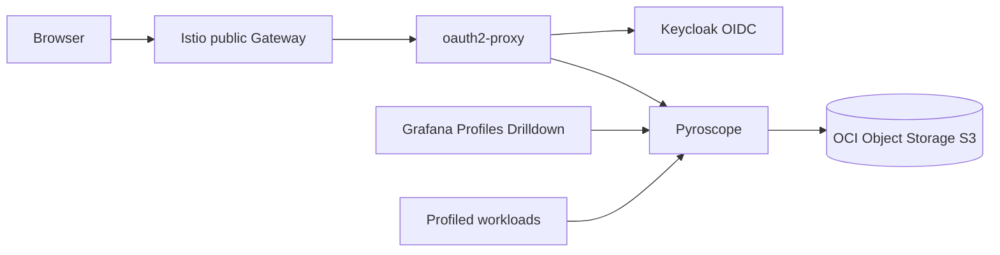

# profiling

Installs Grafana Pyroscope for continuous profiling and exposes the UI through
`oauth2-proxy` when requested.

## Architecture

## Profiles Drilldown Lab

Set `enable_ebpf_lab = true` to install a CPU-bound Python workload and a
privileged Grafana Alloy DaemonSet based on the official Grafana Pyroscope eBPF
Kubernetes example.

- Reference: `github.com/grafana/pyroscope/examples/grafana-alloy-auto-instrumentation/ebpf/kubernetes`
- Namespace: `pyroscope-ebpf`
- Profile service: `pyroscope-ebpf/python-fast-slow`
- Query: `process_cpu:cpu:nanoseconds:cpu:nanoseconds{service_name="pyroscope-ebpf/python-fast-slow"}`

The lab sends profiles to `http://pyroscope.<namespace>.svc.cluster.local:4040`.
It is intended for validation and hands-on training, not production traffic.

Set `enable_go_pprof_lab = true` to install a Go runtime pprof pull-mode lab.
This complements eBPF by exposing runtime-specific profile types through
the standard `/debug/pprof` endpoints. The lab intentionally uses only the Go
standard library, so it validates pull-mode profiling without requiring SDK
changes or extra application dependencies.

- Reference: `github.com/grafana/pyroscope/examples/grafana-alloy-auto-instrumentation/golang-pull`
- Namespace: `pyroscope-go-pprof`
- Profile service: `pyroscope-go/go-pprof-lab`
- CPU query: `process_cpu:cpu:nanoseconds:cpu:nanoseconds{service_name="pyroscope-go/go-pprof-lab"}`
- Memory query: `memory:alloc_space:bytes:space:bytes{service_name="pyroscope-go/go-pprof-lab"}`
- Goroutine query: `goroutine:goroutine:count:goroutine:count{service_name="pyroscope-go/go-pprof-lab"}`
- Mutex query: `mutex:contentions:count:contentions:count{service_name="pyroscope-go/go-pprof-lab"}`
- Block query: `block:contentions:count:contentions:count{service_name="pyroscope-go/go-pprof-lab"}`
- Expected standard pprof profile types: CPU, heap memory, mutex, block, and goroutine.

## Notes

- Use single-binary Pyroscope for Always Free clusters.
- Keep the public UI behind Keycloak; Pyroscope has no native OIDC login.
- Use Object Storage for profile blocks to avoid consuming block volume quota.
- Profile data only appears for workloads that expose profiles or push data.

Retenção opt-in do Pyroscope v1

O parâmetro compactor_blocks_retention_period_seconds é number, com default null.
null omite a flag e conserva os values Helm anteriores, sem selecionar horizonte.
Zero emite compactor.blocks-retention-period=0s e desabilita a retenção por idade.
Um inteiro positivo emite a mesma flag com sufixo s e permite excluir blocos com
amostras anteriores ao período. O intervalo aceito é 0..9223372036 segundos
inteiros, limitado pela representação signed int64 em nanossegundos do Pyroscope.
Não são aceitos números negativos, frações, unidades em strings nem overflow.

O exemplo examples/profiling-minimal não instala recursos nem habilita retenção.
Nenhum período positivo é recomendado ou selecionado por este módulo. Antes de
optar por um período positivo, definir o histórico necessário, escopo, impacto,
janela, dependências, validação operacional e rollback. Reverter para 0/null não
recupera dados já excluídos. null não significa impor zero ao runtime: preserva
os defaults do chart/binário e eventuais overrides por tenant, que devem ser
inspecionados. Um override runtime por tenant pode prevalecer sobre a flag global.

Contrato verificado no código oficial Pyroscope v1.18.0, pkg/validation/limits.go:
limits.compactor_blocks_retention_period equivale à flag
compactor.blocks-retention-period, com zero desabilitando a exclusão por idade.
O chart 1.18.1 passa pyroscope.extraArgs ao processo. Chart, imagem, storage v1,
configuração S3 e credenciais não foram alterados. Trocas futuras de versão
exigem rever este contrato. pyroscopedb.max-block-duration=30m limita a duração
do bloco e NÃO define retenção. Deletion delay também não define idade máxima.

A retenção por idade desabilitada não prova ausência de toda limpeza nem
existência de todo o histórico.
Redução de custo não foi comprovada: Requests pode incluir operações adicionais
de exclusão. Nenhum lifecycle de bucket ou backend Terraform pertence ao escopo.
Este módulo não altera requests/limits de recursos, intervalos de compactação,
rotinas, cloud ou consumidores por efeito deste contrato.

Fontes oficiais preservadas:
https://raw.githubusercontent.com/grafana/pyroscope/v1.18.0/pkg/validation/limits.go
https://github.com/grafana/helm-charts/releases/download/pyroscope-1.18.1/pyroscope-1.18.1.tgz

Validação offline, a partir da raiz do repositório:
TF_BIN=/caminho/terraform python3 tests/test_profiling_retention.py
O teste avalia os values reais via terraform console em diretório temporário,
sem providers, backend remoto, init, plan, apply, credenciais ou acesso cloud.
