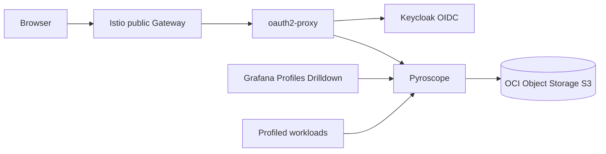

# profiling

Installs Grafana Pyroscope for continuous profiling and exposes the UI through
`oauth2-proxy` when requested.

## Architecture

## Profiles Drilldown Lab

Set `enable_ebpf_lab = true` to install a CPU-bound Python workload and a
privileged Grafana Alloy DaemonSet based on the official Grafana Pyroscope eBPF
Kubernetes example.

- Reference: `github.com/grafana/pyroscope/examples/grafana-alloy-auto-instrumentation/ebpf/kubernetes`
- Namespace: `pyroscope-ebpf`
- Profile service: `pyroscope-ebpf/python-fast-slow`
- Query: `process_cpu:cpu:nanoseconds:cpu:nanoseconds{service_name="pyroscope-ebpf/python-fast-slow"}`

The lab sends profiles to `http://pyroscope.<namespace>.svc.cluster.local:4040`.
It is intended for validation and hands-on training, not production traffic.

## Notes

- Use single-binary Pyroscope for Always Free clusters.
- Keep the public UI behind Keycloak; Pyroscope has no native OIDC login.
- Use Object Storage for profile blocks to avoid consuming block volume quota.
- Profile data only appears for workloads that expose profiles or push data.
