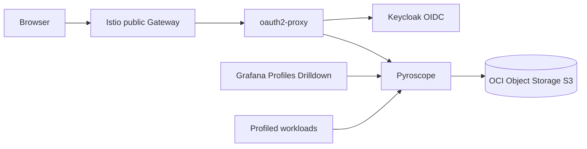

# profiling

Installs Grafana Pyroscope for continuous profiling and exposes the UI through
`oauth2-proxy` when requested.

## Architecture

## Notes

- Use single-binary Pyroscope for Always Free clusters.
- Keep the public UI behind Keycloak; Pyroscope has no native OIDC login.
- Use Object Storage for profile blocks to avoid consuming block volume quota.
- Profile data only appears for workloads that expose profiles or push data.
